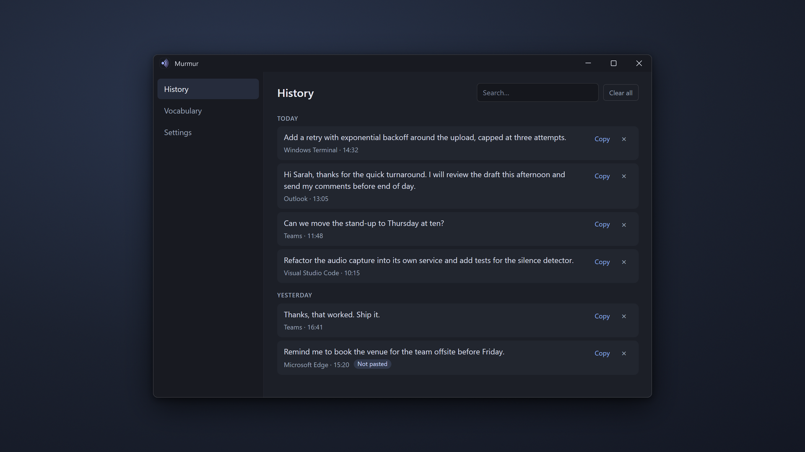

# Murmur

Voice typing for Windows. Hold a hotkey, talk, let go, and the words appear wherever your cursor is: a
terminal, a browser, your editor, mail or chat. Speech is recognised on your own PC with OpenAI's
[Whisper](https://github.com/openai/whisper) model, so nothing you say leaves it.



On the Microsoft Store it is called **Murmur Voice Typing**:
<https://apps.microsoft.com/detail/9N2FVKGMJQ5S>

## What it does

- **Hold to talk.** Hold Right Ctrl (or a hotkey you choose), speak, release. The text is pasted into
  the app you were using.
- **Hands-free.** Tap the hotkey to start, tap again to finish. Esc cancels.
- **Stays out of the way.** A small pill shows while you speak and while Murmur transcribes. It never
  takes focus and disappears as soon as the text is in.
- **Your words, spelled your way.** Hint words help with names and jargon; replacement rules fix
  anything it still gets wrong ("web view two" becomes "WebView2").
- **Nothing gets lost.** Every dictation is kept in a searchable history with one-click copy, even when
  a paste could not happen.
- **Your clipboard is left alone.** It is put back after each paste, and Murmur's own clipboard use
  stays out of Windows clipboard history.
- **Private.** No account, no cloud, no telemetry. See the [privacy policy](https://brudvik.com/murmur/privacy).

## Requirements

- Windows 10 version 2004 (build 19041) or later, x64
- A microphone
- The Microsoft Edge WebView2 Runtime (part of Windows 11 and current Windows 10)
- About 1.6 GB of disk space for the speech model, which Murmur downloads from
  [Hugging Face](https://huggingface.co/ggerganov/whisper.cpp) on first start
- For the fastest transcription: an NVIDIA GPU with the
  [CUDA 13 toolkit](https://developer.nvidia.com/cuda-downloads) installed. Without it Murmur uses your
  graphics card through Vulkan, or the processor, which is slower.

English only. Murmur cannot type into apps that run as administrator, because Windows keeps the
hotkey and the paste from reaching them.

## Building from source

You need the .NET 10 SDK and Node.js 22 or later.

```powershell
dotnet build Murmur.sln                              # also builds the React UI in src/WebApp
dotnet run -c Release --project src/Murmur.UI        # Release bundles the UI; Debug expects the Vite dev server
.\scripts\dev.ps1                                    # Debug with hot reload: Vite dev server + the app
```

Tests:

```powershell
dotnet test tests/Murmur.Core.Tests
dotnet test tests/Murmur.Interop.Tests
dotnet test tests/Murmur.UI.Tests -p:SkipFrontendBuild=true
cd src/WebApp; npm run test:run; npm run lint
```

Some Core tests use real hardware or the real Windows clipboard and skip themselves when it is not
available (no microphone, a locked desktop). The Whisper tests download the speech model on first run.

The Microsoft Store package is built with `build/build-msix.ps1`; see
[docs/store-submission-runbook.md](docs/store-submission-runbook.md).

## How it is put together

| Project | What it holds |
| --- | --- |
| `src/Murmur.Core` | The dictation pipeline: hotkey hook, state machine, audio capture, Whisper engine, text clean-up and vocabulary, clipboard paste, history and settings |
| `src/Murmur.UI` | The WPF shell: tray icon, the recording pill, the main window and app start-up |
| `src/Murmur.Interop` | The bridge between the WPF app and the React UI |
| `src/WebApp` | The main window's UI (React, TypeScript, Vite) shown in WebView2 |
| `packaging/msix` | The Microsoft Store package manifest and assets |

The design and the implementation plan are in [docs/superpowers](docs/superpowers).

## Built with

[whisper.cpp](https://github.com/ggml-org/whisper.cpp) through
[Whisper.net](https://github.com/sandrohanea/whisper.net), [NAudio](https://github.com/naudio/NAudio),
[WPF UI](https://github.com/lepoco/wpfui), [H.NotifyIcon](https://github.com/HavenDV/H.NotifyIcon),
[WebView2](https://developer.microsoft.com/microsoft-edge/webview2/) and [React](https://react.dev).

## License

[MIT](LICENSE) © 2026 Morten Brudvik
